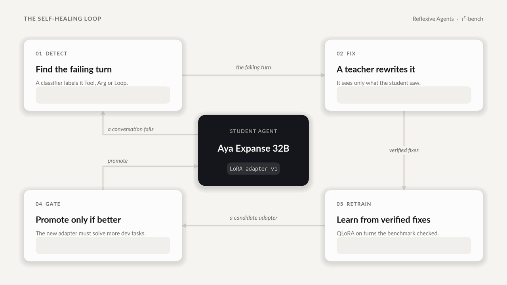

<!-- prettier-ignore -->
<div align="center">

# Reflexive Agents

*An AI agent that heals its own hallucinations: it detects how it went wrong, learns from a
teacher's verified fix, and keeps the update only if it passes a gate.*

[](https://github.com/CharlieGalvin/lexsi-labs-reflexive-agent/actions/workflows/ci.yml)

[](LICENSE)
[](https://github.com/sierra-research/tau2-bench)
<br>
[](https://huggingface.co/reagent-lexsi/sft-aya32b-r16-v2)
[](https://huggingface.co/datasets/reagent-lexsi/tau2-golden-trajectories)
[](docs/blog/reflexive-agents.md)

[Overview](#overview) • [Results](#results) • [How it works](#how-it-works) • [Experiments](#experiments) • [Get started](#get-started) • [Models and data](#models-and-data) • [Resources](#resources)



</div>

Agents are trusted with write access: cancelling orders, changing flights, editing accounts. When
they hallucinate, the result isn't a wrong sentence but a **wrong action**. Reflexive Agents is a
closed loop that turns those failures into training data, built for the Lexsi Labs AI Safety &
Alignment Hackathon (Track 3: Agentic Fine-tuning) on the Lexsi Labs stack.

> [!IMPORTANT]
> **The healed agent solves 51.5% of τ²-bench's test tasks, against 14.5% before healing**, and
> conversations with a hallucinated tool or argument fall from **95% to 10%**. A "be careful"
> prompt changed nothing (13.0%).

## Overview

We gave a 32B open model, **Aya Expanse 32B**, three customer-service jobs on
[τ²-bench](https://github.com/sierra-research/tau2-bench): retail, airline and telecom, with real
tools over a database and a simulated customer. Untuned, it bluffs: it calls tools it doesn't have,
invents IDs like `email="something@example.com"`, and retries failing calls until the conversation
runs out.

The loop heals it with four parts:

- **A classifier** (`reflexive.hallucination`) that labels every failure **Tool**, **Arg** or **Loop**.
- **A teacher**, GLM-5.3-Flash, chosen from 12 models in a bake-off, whose fixes are verified by
  τ²-bench's own evaluator.
- **A trainer** that fits a QLoRA adapter (rank 16) on the fixes.
- **A gate**, agreed before any result, that promotes the new adapter only if it solves more dev
  tasks without more hallucinations.

We ran it two ways: **by hand**, as supervised fine-tuning on the teacher's verified conversations,
and **automatically**, end to end on a GPU pod, where the loop detects, fixes, retrains, gates and
swaps the adapter with no one in it.

## Results

τ²-bench **test split**: 100 tasks × 2 samples per arm, the same student, harness, customer (GPT-4.1)
and decoding. 95% ranges are a bootstrap over tasks.

| Arm | What it is | Success | Retail | Airline | Telecom | Tool or Arg hallucination | Loops |
|---|---|---:|---:|---:|---:|---:|---:|
| **A** | Untuned Aya Expanse 32B | 14.5% (9.5–20.0) | 12.5% | 17.5% | 15.0% | 95.0% | 49.0% |
| **C** | A + "be careful" prompt | 13.0% (7.5–19.0) | 10.0% | 20.0% | 12.5% | 95.5% | 49.5% |
| **B** | **Healed (SFT v2)** | **51.5% (43.5–59.5)** | **60.0%** | **30.0%** | **53.8%** | **10.0%** | **27.0%** |

<div align="center">


</div>

- **Healing works, and it's mostly about data.** B beats A by **+37.0 points** (paired, +28.0 to +45.5).
- **Asking nicely doesn't.** C − A is −1.5 points (−7.0 to +4.0): the model knows the rule, it doesn't follow it.
- **The grain of the fix matters.** Run automatically, fixing only the failing turn cut
  hallucinations by 71% but solved no more dev tasks, so the gate rejected it. Fixing with whole
  verified conversations: TODO (Charlie): the trajectory cycle's result.
- **What's left is decisions.** In 37 of Arm B's 55 failed dev and validation conversations the
  classifier finds no hallucination at all: the agent changed the wrong thing, or didn't change
  the right one.

> [!NOTE]
> Arm B was declared before any test run, every test run is reported, and every success is
> re-scored by AuditKIT's outcome oracle (0 disagreements with τ²-bench). B ran self-hosted at a 32K
> context (2 of its 200 conversations ran past it and count as failures); A and C ran on Cohere's API.

## How it works

1. **Detect.** The student runs train tasks. The classifier finds the first failing turn and its
   type: **Tool** (a tool it doesn't have), **Arg** (an invented, placeholder or ill-typed argument)
   or **Loop** (a repeated or already-failed call).
2. **Fix.** The teacher sees the conversation exactly as the student did and fixes it, either the
   failing turn or the whole task. A fix is kept only if it passes its check.
3. **Retrain.** A QLoRA adapter is trained on the fixes.
4. **Gate.** The adapter replaces the current one only if it solves at least **2 more of the 36 dev
   tasks**, without more hallucinations or any domain losing 2 tasks
   ([`configs/gate.yaml`](configs/gate.yaml)).

The splits are frozen in [`configs/splits.json`](configs/splits.json): **train** 142 tasks (30 held
out as validation, for choosing between versions), **dev** 36 (the gate) and **test** 100 (declared
arms only).

> [!TIP]
> Every number above is recomputed from committed files in seconds, with no GPU or API keys:
> `just reproduce`. See [Get started](#get-started).

## Experiments

Every version was judged by a rule written down before its result. Each has a config, a row in
[`docs/EXPERIMENTS.md`](docs/EXPERIMENTS.md), committed metrics and a write-up.

| Experiment | Question | Result | Write-up |
|---|---|---|---|
| Teacher bake-off | Which teacher? | GLM-5.3-Flash: 88% first try; verified fixes for 158 of 178 tasks, $11 | [phase 2](docs/experiments/TEACHER_PHASE2_RESULTS.md) |
| SFT v1 → v4 | Does fine-tuning on verified fixes heal the student? | v2: dev 11% → 60%, gate promotes: **Arm B**. v3 and v4 matched it, not adopted | [SFT](docs/experiments/SFT.md) |
| Heal cycle, turn-level | Does the automated loop improve the base model? | Findings −71%, dev 4 → 4: rejected | [first cycle](docs/experiments/HEAL_FIRST_CYCLE.md) |
| Heal cycle, trajectory-level | The same loop, fixing with whole verified conversations | TODO (Charlie): result | [plan and result](docs/experiments/HEAL_FROM_V2.md) |
| GRPO G, H, H2 | Can reinforcement learning heal beyond SFT? | G collapsed (0.5/30); H halved loops, rejected; H2 14.5/30 against v2's 17.0 | [GRPO heal](docs/experiments/GRPO_HEAL.md) |
| Runtime monitor | Can a monitor catch loops live? | Fired on all 7 telecom conversations that looped to the step limit, none of the 7 that passed | [monitor](docs/experiments/MONITOR_NO_PROGRESS.md) |

> [!NOTE]
> **Changed from the proposal:** student and teacher swapped on 3 Nov (unaided Aya Expanse 32B
> solved 1 of 30 train tasks); the DSPy prompt arm and BFCL dropped on 5 Nov to focus on τ²-bench;
> the healed arm is SFT rather than GRPO, because no GRPO version beat it under the rules.

## Get started

You need [uv](https://docs.astral.sh/uv/) and [just](https://just.systems). On a Mac:
`brew install uv just`.

```bash
git clone https://github.com/CharlieGalvin/lexsi-labs-reflexive-agent && cd lexsi-labs-reflexive-agent
just setup-dev      # Python 3.12 environment, τ²-bench and its data, test tools
just reproduce      # the five experiments, recomputed from results/ (no GPU, no keys)
```

<details>
<summary><b>Develop and run experiments</b></summary>

> [!WARNING]
> Don't `pip install just`: that's an unrelated Python package. Without Homebrew, use
> `uv tool install rust-just`.

```bash
just setup-dev                  # .venv (Python 3.12) + τ²-bench with its data + test tools; creates .env
#   → open .env and add OPENAI_API_KEY (the retail/airline judges), OPENROUTER_API_KEY (teacher +
#     simulated customer), COHERE_API_KEY (the student, Aya Expanse 32B, for `just rollout`) and
#     HF_TOKEN (your own, for the team HF org): docs/TEACHER_SETUP.md
just check                      # lint + format check + type checks (ty) + tests: what CI runs
just fmt                        # format the code (CI refuses unformatted code)
just features                   # the plain-English specifications (tests/features/), scenario by scenario
just quality                    # advisory: types, dead code (vulture), undeclared dependencies (deptry)
just tau2-first-run telecom     # 2 τ²-bench tasks: official score + cost (a few cents; retail/airline need OPENAI_API_KEY)
source .venv/bin/activate && hf auth login   # then accept the Aya Expanse licence on its model page

# GPU box
just setup                      # also installs the training libraries and AgentTune
```

Run `just` on its own to list every command. Python must be **3.12 or 3.13** (τ²-bench rejects
3.14); `just setup-dev` creates a 3.12 environment for you.

</details>

<details>
<summary><b>Rerun training on a GPU</b></summary>

Training and serving the 32B student needs one H100 (SFT takes about 25 minutes).
[`docs/experiments/SFT_POD.md`](docs/experiments/SFT_POD.md) is the runbook: pod setup, training,
serving with vLLM, scoring. The automated heal cycle is `scripts/heal/cycle.py` (see its docstring).

</details>

## Models and data

| | Hugging Face | Licence |
|---|---|---|
| **Healed model (Arm B)** | [reagent-lexsi/sft-aya32b-r16-v2](https://huggingface.co/reagent-lexsi/sft-aya32b-r16-v2), a LoRA adapter for Aya Expanse 32B | CC BY-NC 4.0 (from Aya) |
| **Every version we trained** | [reagent-lexsi](https://huggingface.co/reagent-lexsi): 10 adapters, adopted or not, each with its result and `lexsi_provenance.json` | CC BY-NC 4.0 |
| **Verified teacher conversations** | [reagent-lexsi/tau2-golden-trajectories](https://huggingface.co/datasets/reagent-lexsi/tau2-golden-trajectories): 127 train + 31 dev conversations, plus the hard subset | CC BY-NC 4.0 (customer turns are GPT-4.1 outputs) |

The code in this repo is [MIT](LICENSE). Third-party code (τ²-bench, AgentTune) isn't committed:
`just setup-dev` clones it, under its own licence.

<details>
<summary><b>Repo layout</b></summary>

```
configs/                 one YAML per experiment / arm (copy, don't edit in place)
  splits.json            frozen τ²-bench train / dev / test task IDs (SEL-36; never regenerate)
  arms.yaml              the experiment arms: shared student and customer, one prompt per arm (SEL-41)
  prompts.yaml           the arms' versioned prompt texts (e.g. careful/v1); never edit a version in place
src/reflexive/           Python package: each role adds its modules here
  outcome.py             pass/fail for any τ²-bench trajectory via τ²-bench's own scoring (Curator)
  episode.py             one τ²-bench conversation our code drives: tools, customer, context guard (Curator)
  arms.py                the experiment arms (configs/arms.yaml) and one rollout of an arm (Architect)
  llm.py                 API model names and OpenRouter prices
  splits.py              load the frozen splits; split_of(), assert_not_test()
  teacher.py             Cohere `Action:` prompt format (to_prompted) and tool-call parsing; Cohere client
  golden.py              golden trajectories v1: agent's view, clean-pass pick, Cohere conversion, checks
scripts/                 command-line tools, one folder per job (scripts/README.md lists each one)
  tau2/                  τ²-bench: first run, cost report, scorer checks, tool schemas
  teacher/               the teacher bake-off and the fix run that made the golden trajectories
  student/               Aya's failure review
  arms/                  experiment arms: rollouts (`just rollout A retail`), classifier spot check
  data/                  frozen splits, golden trajectories v1, the Hugging Face upload
  sft/                   SFT training (QLoRA) and serving the student (Arm B)
  grpo/                  the GRPO runs (G, H, H2)
  heal/                  the automated heal cycle (`cycle.py`: detect → fix → retrain → gate)
  pod/                   GPU pod setup, vLLM serving and the heal service
  blog/                  the blog's figures, number check and `just reproduce`
  archive/               early probes, kept for the record
third_party/             τ²-bench v2.0.0 (with data) and AgentTune, cloned by `just setup-dev` / `just setup`
tests/                   offline tests (no GPU) — run in CI on every PR
docs/DATA_CONTRACT.md    what the Curator hands over: the five rules, the files and the record format
docs/TAU2_SETUP.md       τ²-bench setup decisions (splits, judges, context fit, costs)
docs/TEACHER_SETUP.md    teacher (GLM-5.3-Flash via OpenRouter) and the Cohere prompt format Aya uses
docs/experiments/        every experiment's plan, rule and result, in order (start at its README)
docs/blog/               the project write-up (Hugging Face blog format)
docs/WORKPLAN.md         the original 2 Nov plan (live tracking is in Linear)
docs/EXPERIMENTS.md      one row per run
results/*.metrics.json   committed evidence for the demo
```

</details>

## Feedback for Lexsi Labs

TODO (team): our feedback and feature requests for AgentTune, AuditKIT and DECIDE. Notes so far:

- **AgentTune:** `FailureDetector` sees only tool calls, so it misses text-only loops (repeated
  replies); our `reflexive.monitor` stands in for it. `lexsi_provenance.json` worked well as the
  lineage record for every adapter we published.
- **AuditKIT:** the outcome oracle agreed with τ²-bench's own verdicts on all 600 test conversations.
  `agent_loop_detection` counts near-identical replies (e.g. repeated goodbyes) as loops, so it
  couldn't tell arms A and B apart (126 against 125 of 200) where our classifier could (49% against 27%).
- **DECIDE:** TODO.

## Resources

- **[Blog post](docs/blog/reflexive-agents.md):** the project, told end to end.
- **[Experiments, in order](docs/experiments/README.md)** and **[every run](docs/EXPERIMENTS.md)**.
- **[τ²-bench](https://github.com/sierra-research/tau2-bench)** and the Lexsi Labs stack:
  [AgentTune](https://github.com/Lexsi-Labs/AgentTune), [AuditKIT](https://github.com/Lexsi-Labs/AuditKIT),
  [CuratorKIT](https://github.com/Lexsi-Labs/CuratorKIT).

<details>
<summary><b>Cite τ²-bench</b></summary>

```bibtex
@article{barres2025tau2,
  title   = {$\tau^2$-Bench: Evaluating Conversational Agents in a Dual-Control Environment},
  author  = {Barres, Victor and Dong, Honghua and Ray, Soham and Si, Xujie and Narasimhan, Karthik},
  journal = {arXiv preprint arXiv:2506.07982},
  year    = {2025}
}
```

</details>

---

Built by **Katie** ([katiemarieek](https://huggingface.co/katiemarieek)), **Chiara Picardi**
([cp89](https://huggingface.co/cp89)) and **Charlie Galvin** ([cg3849](https://huggingface.co/cg3849))
for the Lexsi Labs AI Safety & Alignment Hackathon, November 2026.
