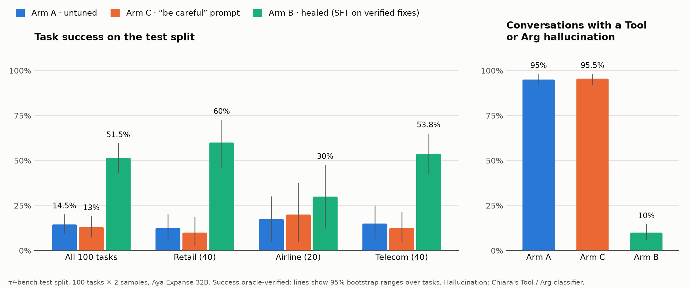
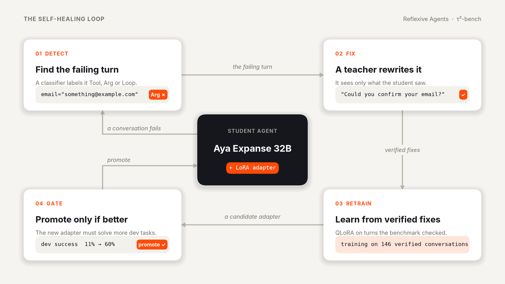

# Reflexive Agents

**A self-healing loop for agent hallucination: detect the failure, have a teacher fix it, retrain,
and keep the result only if it passes a gate.**

Lexsi Labs AI Safety & Alignment Hackathon (Nov 2026) · Track 3: Agentic Fine-tuning ·
Katie ([katiemarieek](https://huggingface.co/katiemarieek)), Chiara Picardi
([cp89](https://huggingface.co/cp89)), Charlie Galvin ([cg3849](https://huggingface.co/cg3849))

**[Blog post](docs/blog/reflexive-agents.md)** ·
**[Healed model (Arm B)](https://huggingface.co/reagent-lexsi/sft-aya32b-r16-v2)** ·
**[All adapters](https://huggingface.co/reagent-lexsi)** ·
**[Dataset](https://huggingface.co/datasets/reagent-lexsi/tau2-golden-trajectories)** ·
**[Every run](docs/EXPERIMENTS.md)**

---

## Findings

On [τ²-bench](https://github.com/sierra-research/tau2-bench) (retail, airline and telecom customer
service, scored by the final database state), with **Aya Expanse 32B** as the student and
**GLM-5.3-Flash** as the teacher:

- **Healing works, and it's mostly about data.** Training on the teacher's verified conversations
  took the student from **14.5% to 51.5%** of test tasks, and cut conversations with a hallucinated
  tool or argument from **95% to 10%**.
- **Asking nicely doesn't.** A "be careful not to hallucinate" prompt changed nothing (13.0%).
- **The grain of the fix matters.** Run automatically, the loop fixing only the failing turn cut
  hallucinations by 71% but solved no more dev tasks, so the gate rejected it. Fixing with whole
  verified conversations: TODO (Charlie): the trajectory cycle's result.
- **Reinforcement learning didn't beat fine-tuning.** Three GRPO designs fell short of Arm B, and
  showed that a healing reward has to judge *decisions*, not just hallucinations.
- **What's left is decisions.** In 37 of Arm B's 55 failed dev and validation conversations, the
  hallucination classifier finds nothing: the agent changed the wrong thing, or didn't change the
  right one.

## Results (τ²-bench test split)

100 test tasks × 2 samples per arm, the same student, harness, customer (GPT-4.1) and decoding.
Success is re-scored by AuditKIT's outcome oracle (0 disagreements with τ²-bench's own verdicts).
95% ranges are a bootstrap over tasks.

| Arm | What it is | Success | Retail | Airline | Telecom | Tool or Arg hallucination | Loops |
|---|---|---:|---:|---:|---:|---:|---:|
| **A** | Untuned Aya Expanse 32B | 14.5% (9.5–20.0) | 12.5% | 17.5% | 15.0% | 95.0% | 49.0% |
| **C** | A + "be careful" prompt | 13.0% (7.5–19.0) | 10.0% | 20.0% | 12.5% | 95.5% | 49.5% |
| **B** | **Healed: SFT v2 on verified teacher conversations** | **51.5% (43.5–59.5)** | **60.0%** | **30.0%** | **53.8%** | **10.0%** | **27.0%** |

Paired differences: **B − A +37.0 points (+28.0 to +45.5)**, B − C +38.5 (+29.0 to +47.5),
C − A −1.5 (−7.0 to +4.0). Arm B was declared before any test run; every test run is reported.
Hallucination and loops are per conversation, from our Tool / Arg / Loop classifier
(`reflexive.hallucination`). B ran self-hosted at a 32K context (2 of its 200 conversations ran
past it and count as failures); A and C ran on Cohere's API.



## How it works



1. **Detect.** The student runs train tasks; the classifier labels each failure **Tool** (a tool it
   doesn't have), **Arg** (an invented argument) or **Loop** (a repeated or failed call).
2. **Fix.** The teacher, GLM-5.3-Flash, fixes it: either the failing turn, or the whole task.
   A fix is kept only if τ²-bench's evaluator (or our fix check) passes it.
3. **Retrain.** A QLoRA adapter (rank 16) is trained on the fixes.
4. **Gate.** The new adapter replaces the current one only if it solves at least 2 more of the 36
   dev tasks, without more hallucinations or a domain losing 2 tasks
   ([`configs/gate.yaml`](configs/gate.yaml), agreed before any result).

The splits are frozen ([`configs/splits.json`](configs/splits.json)): **train** 142 tasks (30 of
them held out as validation, for choosing between versions), **dev** 36 (the gate), **test** 100
(declared arms only). Test tasks are never used for training, fixes or choices.

## Experiments

| Experiment | Question | Result | Write-up |
|---|---|---|---|
| Teacher bake-off | Which teacher? | GLM-5.3-Flash: 88% of train tasks first try; verified fixes for 158 of 178 tasks, $11 | [phase 2](docs/experiments/TEACHER_PHASE2_RESULTS.md) |
| SFT v1 → v4 | Does SFT on verified fixes heal the student? | v2: dev 11% → 60%, gate promotes; **Arm B**. v3, v4 matched v2 on validation, not adopted | [SFT](docs/experiments/SFT.md) |
| Heal cycle, turn-level | Does the automated loop improve the base model? | Findings −71%, dev 4 → 4: gate rejects | [first cycle](docs/experiments/HEAL_FIRST_CYCLE.md) |
| Heal cycle, trajectory-level | The same loop, fixing with whole verified conversations | TODO (Charlie): result | [plan and result](docs/experiments/HEAL_FROM_V2.md) |
| GRPO G, H, H2 | Can RL heal beyond SFT? | G collapsed (0.5/30); H halved loops but the gate rejected it; H2 14.5/30, below v2's 17.0 | [GRPO heal](docs/experiments/GRPO_HEAL.md) |
| Runtime monitor | Can a monitor stop loops live? | On telecom train runs it fired on all 7 conversations that looped to the step limit, and on none of the 7 that passed | [monitor](docs/experiments/MONITOR_NO_PROGRESS.md) |

Every run has a config, a row in [`docs/EXPERIMENTS.md`](docs/EXPERIMENTS.md) and committed metrics
in [`results/`](results/). Each version was judged by a rule written before its result.

**What changed from the proposal:** the student and teacher were swapped on 3 Nov (unaided Aya
Expanse 32B solved 1 of 30 train tasks, so it became the student; GLM-5.3-Flash won the teacher
bake-off). The DSPy prompt arm (D) and BFCL were dropped on 5 Nov to focus on τ²-bench. The healed
arm is SFT rather than GRPO, because no GRPO version beat it under the rules fixed in advance.

## Reproduce

Every result is recomputed from the committed files in seconds, with no GPU or API keys:

```bash
just reproduce          # the blog's five experiments, each ending with the commands that rerun it
just blog-check         # checks every number in the blog against results/
```

Rerunning from scratch needs a GPU (one H100 for the 32B student) and API keys:
[`docs/experiments/SFT_POD.md`](docs/experiments/SFT_POD.md) is the runbook.

## Feedback for Lexsi Labs

TODO (team): our feedback and feature requests for AgentTune, AuditKIT and DECIDE. Notes so far:

- **AgentTune:** `FailureDetector` sees only tool calls, so it misses text-only loops (repeated
  replies); our `reflexive.monitor` stands in for it. `lexsi_provenance.json` worked well as the
  lineage record for every adapter we published.
- **AuditKIT:** the outcome oracle agreed with τ²-bench's own verdicts on all 600 test conversations.
  `agent_loop_detection` counts near-identical replies (e.g. repeated goodbyes) as loops, so it
  couldn't tell arms A and B apart (126 against 125 of 200) where our classifier could (27% against 49%).
- **DECIDE:** TODO.

## Citation

```bibtex
@article{barres2025tau2,
  title   = {$\tau^2$-Bench: Evaluating Conversational Agents in a Dual-Control Environment},
  author  = {Barres, Victor and Dong, Honghua and Ray, Soham and Si, Xujie and Narasimhan, Karthik},
  journal = {arXiv preprint arXiv:2506.07982},
  year    = {2025}
}
```

## Quick start

Needs two small tools, once per machine: [uv](https://docs.astral.sh/uv/) (Python + packages)
and [just](https://just.systems) (task runner). On a Mac: `brew install uv just`.
Don't `pip install just`: that's an unrelated Python package with the same name. Without
Homebrew, use `uv tool install rust-just`. Check with `which just`: it should not be inside `.venv`.

```bash
git clone https://github.com/CharlieGalvin/lexsi-labs-reflexive-agent && cd lexsi-labs-reflexive-agent
just setup-dev                  # .venv (Python 3.12) + τ²-bench with its data + test tools; creates .env
#   → open .env and add OPENAI_API_KEY (the retail/airline judges), OPENROUTER_API_KEY (teacher +
#     simulated customer), COHERE_API_KEY (the student, Aya Expanse 32B, for `just rollout`) and
#     HF_TOKEN (your own, for the team HF org): docs/TEACHER_SETUP.md
just check                      # lint + format check + type checks (ty) + tests: what CI runs
just fmt                        # format the code (CI refuses unformatted code)
just features                   # the plain-English specifications (tests/features/), scenario by scenario
just quality                    # advisory: types, dead code (vulture), undeclared dependencies (deptry)
just tau2-first-run telecom     # 2 τ²-bench tasks: official score + cost (a few cents; retail/airline need OPENAI_API_KEY)
source .venv/bin/activate && hf auth login   # then accept the Aya Expanse licence on its model page

# GPU box
just setup                      # also installs the training libraries and AgentTune
```

Run `just` on its own to list every command. Python must be **3.12 or 3.13** (τ²-bench rejects
3.14); `just setup-dev` creates a 3.12 environment for you.

## Repo layout

```
configs/                 one YAML per experiment / arm (copy, don't edit in place)
  splits.json            frozen τ²-bench train / dev / test task IDs (SEL-36; never regenerate)
  arms.yaml              the experiment arms: shared student and customer, one prompt per arm (SEL-41)
  prompts.yaml           the arms' versioned prompt texts (e.g. careful/v1); never edit a version in place
src/reflexive/           Python package: each role adds its modules here
  outcome.py             pass/fail for any τ²-bench trajectory via τ²-bench's own scoring (Curator)
  episode.py             one τ²-bench conversation our code drives: tools, customer, context guard (Curator)
  arms.py                the experiment arms (configs/arms.yaml) and one rollout of an arm (Architect)
  llm.py                 API model names and OpenRouter prices
  splits.py              load the frozen splits; split_of(), assert_not_test()
  teacher.py             Cohere `Action:` prompt format (to_prompted) and tool-call parsing; Cohere client
  golden.py              golden trajectories v1: agent's view, clean-pass pick, Cohere conversion, checks
scripts/                 command-line tools, one folder per job (scripts/README.md lists each one)
  tau2/                  τ²-bench: first run, cost report, scorer checks, tool schemas
  teacher/               the teacher bake-off and the fix run that made the golden trajectories
  student/               Aya's failure review
  arms/                  experiment arms: rollouts (`just rollout A retail`), classifier spot check
  data/                  frozen splits, golden trajectories v1, the Hugging Face upload
  sft/                   SFT training (QLoRA) and serving the student (Arm B)
  grpo/                  the GRPO runs (G, H, H2)
  heal/                  the automated heal cycle (`cycle.py`: detect → fix → retrain → gate)
  pod/                   GPU pod setup, vLLM serving and the heal service
  blog/                  the blog's figures, number check and `just reproduce`
  archive/               early probes, kept for the record
third_party/             τ²-bench v2.0.0 (with data) and AgentTune, cloned by `just setup-dev` / `just setup`
tests/                   offline tests (no GPU) — run in CI on every PR
docs/DATA_CONTRACT.md    what the Curator hands over: the five rules, the files and the record format
docs/TAU2_SETUP.md       τ²-bench setup decisions (splits, judges, context fit, costs)
docs/TEACHER_SETUP.md    teacher (GLM-5.3-Flash via OpenRouter) and the Cohere prompt format Aya uses
docs/experiments/        every experiment's plan, rule and result, in order (start at its README)
docs/blog/               the project write-up (Hugging Face blog format)
docs/WORKPLAN.md         the original 2 Nov plan (live tracking is in Linear)
docs/EXPERIMENTS.md      one row per run
results/*.metrics.json   committed evidence for the demo
```

## Team workflow

- Work is tracked in **Linear**: [Reflexive Agents project](https://linear.app/self-healing-hallucination/project/reflexive-agents-e8769e1623aa)
  (issues `SEL-5`…`SEL-30`, milestones M1–M4, role labels Curator / Architect / Trainer / Shared).
- Branch per issue using Linear's branch name (copy it from the issue, e.g. `charliegalvin/sel-12-…`),
  or mention `SEL-12` in the PR title — Linear moves the issue to In Progress / Done automatically.
- PR into `main`, CI must pass, one review.
- Every run gets a config file, an `EXPERIMENTS.md` row and a committed `metrics.json`.
- Models, adapters and datasets go to the team HF org [reagent-lexsi](https://huggingface.co/reagent-lexsi), not git.

## Licences

- **This repo's code:** [MIT](LICENSE). Third-party code (τ²-bench, AgentTune) isn't committed here:
  `just setup-dev` clones it, under its own licence.
- **Our adapters and dataset:** CC BY-NC 4.0. The adapters inherit Aya Expanse 32B's licence; the
  dataset's customer turns are GPT-4.1 outputs, under OpenAI's terms (see each card).
- **The Lexsi Labs stack:** AgentTune (LSAL v1.1) and AuditKIT (LSAL v1.2) are source-available for
  research and non-commercial use, not OSI open source.
- **τ²-bench:** MIT.
