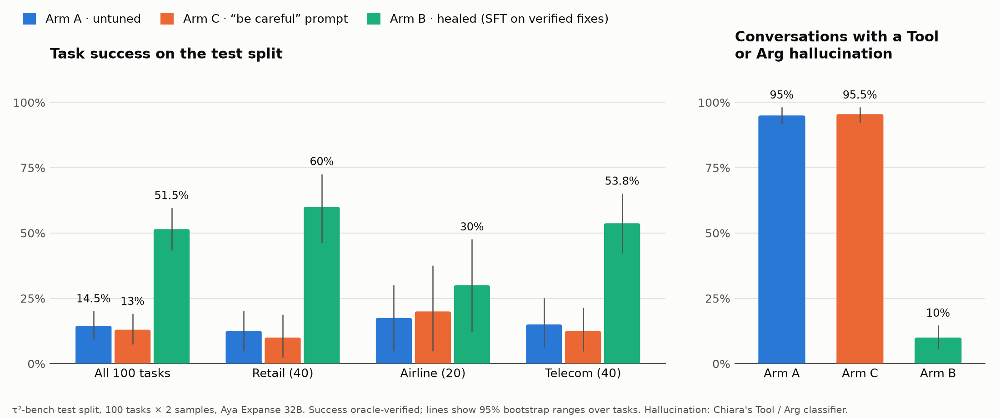
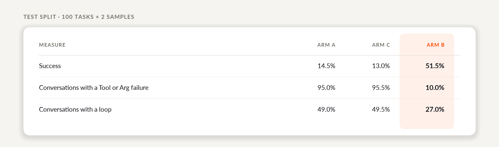

# Reflexive Agents: Teaching a 32B Model to Heal Its Own Hallucinations

Agents are increasingly trusted with write access: cancelling orders, changing flights, editing
accounts. When they hallucinate, the result isn't a wrong sentence but a wrong action. They call a
tool they don't have, invent an order ID, or retry a failing call until the conversation runs out.

We wanted to know whether an agent can **heal itself**: detect how it went wrong, have a stronger
model correct the failing turn, retrain on the correction, and keep the result only if it passes a
gate. We built this loop on [τ²-bench](https://github.com/sierra-research/tau2-bench), with
**Aya Expanse 32B** as the student and **GLM-5.3-Flash** as the teacher, using the Lexsi Labs stack
([AgentTune](https://github.com/Lexsi-Labs/AgentTune), AuditKIT and DECIDE).

**What we found:**

* **Healing works, and it's mostly about data.** Fine-tuning on the teacher's verified fixes took
  the student from **14.5% to 51.5%** of test tasks, and cut conversations with a hallucinated tool
  or argument from **95% to 10%**.
* **Asking nicely doesn't.** A "be careful not to hallucinate" instruction changed nothing.
* **Reinforcement learning didn't beat fine-tuning.** But it showed what a healing reward has to
  measure: not just *how* the agent acts, but *whether* it should.

### The idea, without the jargon

Picture a new trainee on a customer help desk. They're quick and polite, but under pressure they
bluff: they quote an order number that doesn't exist, use a system they don't have access to, or
press the same broken button again and again. That's an agent **hallucinating**.

Now give the trainee a senior colleague who replays each call that went wrong, stops at the exact
moment it went off track, and writes down what should have been said. The trainee practises on
those corrections: that's **teacher–student training**. Before they go back on the phones, a
manager runs them through a set of test calls and signs them off only if they solve more than
before.

Spot the mistake, get the correction, practise, pass the check, and repeat: that's
**self-healing**. In our project the trainee is a 32B open model, the senior colleague is a
stronger model, and the manager is a benchmark with a rulebook fixed in advance.

### The loop: detect, fix, retrain, gate


1. **Detect.** A classifier finds the first failing turn and its type: Tool, Arg or Loop.
2. **Fix.** The teacher sees the conversation exactly as the student did, up to that turn, and
   rewrites it. A fix is kept only if it's a real turn, doesn't give up, and has no Tool, Arg or
   Loop failure of its own. Fixes cost about $0.001 each.
3. **Retrain.** The student's LoRA adapter is trained on the fixes.
4. **Gate.** The new adapter replaces the old one only if it does better on the dev split, under a
   rule agreed in advance.

A runtime monitor also watches live conversations for loops. On telecom it flagged all 7 that
looped to the step limit, and none of those that passed.

### The setup

τ²-bench gives an agent a simulated customer, a policy and real tools over a database, in three
domains: retail, airline and telecom. A conversation passes only if the database (and in telecom,
the customer's phone) ends in exactly the right state. That makes it a good test of
hallucination: an invented argument doesn't just read badly, it changes the wrong record.

We froze the splits early (train 142 tasks, dev 36, test 100) and gave each one a single job.
Train is for training, a held-out slice of train for choosing between versions, dev for the
deployment gate, and test only for models declared in advance.

To pick the teacher, we screened 12 models, then ran the two finalists on every train task.
GLM-5.3-Flash passed 88% on the first try and produced verified fixes for 158 of 178 tasks, for
**$11** in total.

### What a hallucinating agent looks like

Untuned, the student passed 7 of 30 train tasks. Its tool-call format was fine (0 unreadable calls
in 266 replies), so every failure was behaviour. It called tools it didn't have, invented IDs,
retried calls that had already failed, and batched calls that depended on each other.

To measure this at scale, we wrote a classifier that labels every structural failure in a
conversation:


On the test split, the untuned student had a Tool or Arg failure in **95% of conversations**.

### Can you just tell it to be careful?

The cheapest fix is a prompt. With a fixed instruction not to hallucinate, the student scored
13.0% against 14.5% without it (a difference of −1.5 points, 95% range −7.0 to +4.0), and still
hallucinated in 95.5% of conversations. The model knows the rule; it doesn't follow it.

### One turn of the loop

We ran one full cycle end to end. The teacher fixed **24 of 24** failures, and the healed adapter
made **71% fewer** Tool, Arg and Loop errors per conversation. But it solved the same number of
dev tasks, 4 against 4, so the gate rejected it. Fewer hallucinations isn't the goal on its own;
solving tasks is. One cycle of 16 fixes was too small a signal, so we trained on many verified
conversations at once.

### Result 1: fine-tuning on verified fixes

We fine-tuned the student (QLoRA, rank 16) on the teacher's verified conversations. A first
version raised dev success from 11% to 38%. The gate rejected it on airline, where it now made
changes nobody had asked for. Adding 34 airline conversations fixed that, and reached **60% on
dev**. We declared this version as **Arm B** and ran it on the 100 test tasks, against the
untuned student (**Arm A**) and the careful prompt (**Arm C**):





**Arm B beats Arm A by 37 points** (95% range +28 to +46). The gain is largest in retail and
telecom, and smallest in airline, where the remaining failures are policy decisions rather than
hallucinations.

### Result 2: what reinforcement learning taught us

We then tried to heal further with GRPO, starting from Arm B. Each training prompt is a
conversation up to one agent turn; the model writes that turn 8 times, and a reward scores each
attempt.

**Our first run trained only on the teacher's tool calls.** The model learned that calling a tool
was always rewarded, stopped replying to customers, and collapsed: 0.5 of 30 on held-out tasks,
against Arm B's 17.0.

**Our second run followed the loop.** It trained on 177 teacher fixes at real failures, with one
reward per failure type (Tool, Arg and Loop), plus agreement with the teacher's fix. It didn't
collapse, halved loops, and cut repeated calls in telecom from 45% to 7%. But it solved fewer
tasks than Arm B (51% against 60% on dev), and the gate rejected it.

The conversations it lost weren't hallucinations. They were **decisions**. It cancelled airline
reservations nobody asked it to cancel, and in telecom it walked customers through phone settings
but skipped the fix on its own side of the account. A cancellation with a real reservation ID
passes every hallucination check, whether or not it should happen. **Rewarding the absence of
hallucination taught the model to act confidently, not correctly.**

**Our third run added a decision reward.** It checked each change against the changes the task
still expected. It drifted towards calling tools, and a guard we'd built to watch the share of
replies stopped training early. It scored 14.5 of 30, below Arm B's 17.0.

TODO (Charlie): H3, the revised decision reward, when its result is in.

### What we learned

* **Verified data beats instructions.** What healed the agent was hundreds of correct turns, each
  checked by the benchmark's own evaluator.
* **Decide the rule before you see the result.** Every model we trained was judged by a rule
  written down before it ran. Several promising ideas didn't pass, and the rules kept us honest.
* **Fewer hallucinations isn't the same as more success.** The gate caught this twice.
* **Hallucinations and decision errors are different problems.** Once the hallucinations were
  gone, the remaining failures were about what to change, and when. That's the next frontier for
  self-healing agents.

### Reproduce it yourself

Every run saved its results, so you can step through all five experiments on a laptop in seconds,
with no GPU or API keys. Each one is introduced, recomputed from the saved results, and ends with
the commands that rerun it from scratch:

```bash
git clone <repo> && cd <repo>
just reproduce            # or: python scripts/blog/reproduce.py
```


It ends by checking that every number it recomputed appears in this post exactly as written.

### What's next

The next step is a reward that judges decisions as well as structure, and scores whole
conversations rather than single turns. We'd love to hear how others approach it.

TODO: links to the code and any published adapters.

### Acknowledgements

TODO: thanks to Lexsi Labs for the hackathon and the stack, with our feedback on AgentTune,
AuditKIT and DECIDE.
