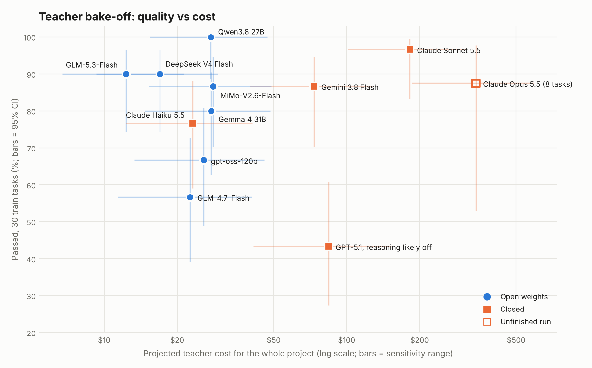

# Teacher bake-off, phase 1: results (3 Nov 2026, SEL-58)

**Recommendation:** use an **open-weight teacher**, either **GLM-5.3-Flash** or **Qwen3.8 27B**,
and confirm the choice in phase 2. Both are statistically indistinguishable from the best closed
model (Claude Sonnet 5.5). They cost $12–28 for the whole project against Sonnet's ~$182, and
their licences let us train on, and publish, their outputs.

Design: [`TEACHER_BAKEOFF.md`](TEACHER_BAKEOFF.md). Reproduce with
`python scripts/bakeoff_report.py`, then `python scripts/bakeoff_plot.py <json> <png>`.

## Setup

- **Tasks:** the same fixed 30 τ²-bench v2.0 *train* tasks for every model: 20 retail and
  10 airline, sampled with seed 0, all needing a database change. Every model saw every task,
  so comparisons are paired.
- **One attempt** per task per model. Temperature 0 where the model accepts it. GPT-4.1 as the
  simulated customer.
- **Scoring:** τ²-bench's own evaluator, **database checks only**. The LLM judges (retail NL
  assertions, airline communicate check) were off, so a pass is a best case: a fail is certain,
  a pass might still fail a judge.
- **Agent:** native tool calling through OpenRouter, with providers required to support every
  parameter we send.

## Results

| Teacher | Weights | Passed | 95% CI | Retail | Airline | Agent $/conv | Customer $/conv | Project total (range) |
|---|---|---:|---|---:|---:|---:|---:|---:|
| **Qwen3.8 27B** | open | **30/30** | 89–100% | 20/20 | 10/10 | 0.027 | 0.011 | **$28** ($15–47) |
| Claude Sonnet 5.5 | closed | 29/30 | 83–99% | 19/20 | 10/10 | 0.232 | 0.012 | $182 ($101–313) |
| **GLM-5.3-Flash** | open | 27/30 | 74–97% | 17/20 | 10/10 | **0.003** | 0.013 | **$12** ($7–21) |
| DeepSeek V4 Flash | open | 27/30 | 74–97% | 18/20 | 9/10 | 0.008 | 0.014 | $17 ($9–29) |
| Gemini 3.8 Flash | closed | 26/30 | 70–95% | 18/20 | 8/10 | 0.075 | 0.016 | $73 ($40–128) |
| MiMo-V2.6-Flash | open | 26/30 | 70–95% | 17/20 | 9/10 | 0.015 | 0.020 | $28 ($15–49) |
| Gemma 4 31B | open | 24/30 | 63–90% | 18/20 | 6/10 | 0.017 | 0.016 | $28 ($15–48) |
| Claude Haiku 5.5 | closed | 23/30 | 59–88% | 17/20 | 6/10 | 0.013 | 0.014 | $23 ($12–41) |
| gpt-oss-120b | open | 20/30 | 49–81% | 15/20 | 5/10 | 0.013 | 0.015 | $26 ($13–46) |
| GLM-4.7-Flash | open | 17/30 | 39–73% | 14/20 | 3/10 | 0.007 | 0.015 | $23 ($11–41) |
| Qwen3 32B (thinking off) | open | 14/30 | 30–64% | 13/20 | 1/10 | 0.009 | 0.015 | $27 ($13–49) |
| GPT-5.1 † | closed | 13/30 | 27–61% | 12/20 | 1/10 | 0.044 | 0.029 | $84 ($41–153) |
| Claude Opus 5.5 ‡ | closed | 7/8 | 53–98% | 7/8 | – | 0.417 | 0.011 | $341 ($185–593) |
| *Aya Expanse 32B (student)* | open | 1/30 | 1–17% | 0/20 | 1/10 | – | – | – |
| *Tiny Aya* | open | 0/30 | 0–11% | 0/20 | 0/10 | – | – | – |

† Almost certainly ran with reasoning off, which is GPT-5.1's API default. Not representative
of the model; rerun with reasoning on if we want it as a reference.
‡ Unfinished: 8 of 30 tasks, all retail, so it isn't comparable yet.

The 95% CIs are Wilson score intervals. **Costs:**
- **Closed models:** OpenRouter's billed cost.
- **Open models:** list price × tokens, with no cache discount, so they may run slightly high.
- **Customer:** GPT-4.1's cost per conversation.

## Statistical analysis

**1. The top four can't be told apart on 30 tasks.** Every model saw the same tasks, so we
compare them task by task with an **exact McNemar test**: a two-sided binomial test on the tasks
where exactly one of the pair passed. We correct for the 6 comparisons (Holm), and give a
**paired bootstrap** 95% interval for the difference in pass rate (10,000 resamples of the 30
tasks):

| Pair | Tasks only A passed | Tasks only B passed | p | Holm p | Difference (95%) |
|---|---:|---:|---:|---:|---|
| Qwen3.8 27B vs Sonnet 5.5 | 1 | 0 | 1.00 | 1.00 | 0 to +10 pts |
| Qwen3.8 27B vs GLM-5.3-Flash | 3 | 0 | 0.25 | 1.00 | 0 to +23 pts |
| Qwen3.8 27B vs DeepSeek V4 Flash | 3 | 0 | 0.25 | 1.00 | 0 to +23 pts |
| Sonnet 5.5 vs GLM-5.3-Flash | 2 | 0 | 0.50 | 1.00 | 0 to +17 pts |
| Sonnet 5.5 vs DeepSeek V4 Flash | 3 | 1 | 0.63 | 1.00 | −7 to +20 pts |
| GLM-5.3-Flash vs DeepSeek V4 Flash | 1 | 1 | 1.00 | 1.00 | −10 to +10 pts |

None of these differences is significant. Paying 15× more for Sonnet buys no measurable quality
over the open models here.

**2. The large gaps are real.** Against the same 30 tasks:
- **Every candidate teacher beats Aya Expanse 32B** (p ≤ 0.002 for all; e.g. Qwen3.8 27B 29
  tasks vs 0, p = 4×10⁻⁹). This confirms the earlier finding that unaided Aya can't teach.
- **The top tier beats GLM-4.7-Flash**, our first pick: Qwen3.8 27B 13 vs 0 (p = 0.0002),
  GLM-5.3-Flash 11 vs 1 (p = 0.006). So moving up from GLM-4.7-Flash is justified.
- **Gemma 4, Haiku 5.5 and gpt-oss-120b don't clearly beat GLM-4.7-Flash** (p = 0.07–0.45).

**3. What 30 paired tasks can and can't detect.** The power of an exact McNemar test at
α = 0.05, simulated with independent tasks:

| True pass rates | 30 tasks | 70 tasks | 210 tasks |
|---|---:|---:|---:|
| 95% vs 85% | 10% | 39% | 91% |
| 95% vs 75% | 44% | 90% | 100% |
| 90% vs 60% | 68% | 98% | 100% |

So 30 tasks is **good enough to screen**: it reliably separates a ~90% model from a ~60% one.
It **can't** rank models that are within ~10–20 points of each other. Phase 2's 70 tasks catch
a 20-point gap 90% of the time. To catch 10 points we'd need ~200 independent tasks.

That 210 = 70 tasks × 3 attempts doesn't count as 210 independent tasks: attempts on the same
task are correlated. For ranking, phase 2 should compare **per-task** results (pass@3, pass^3)
rather than pooling the attempts.

**4. Where the models fail is shared, not random.** Retail 76 and 98 were failed by 9 of the
12 full-run teachers, and airline 14 and 23 by 7. Some tasks are hard for everyone, so
treating tasks as independent coin flips overstates the precision a little. These shared
failures are also good candidates for the hard-hallucination subset (SEL-7).

**5. Invented-ID flags in the top tier are false positives.** The 3 "invented ID" conversations
for Qwen3.8, Sonnet and GLM-5.3 are all airline 15, 20 and 33. The flagged values are **flight
dates** (e.g. `2024-05-24`) worked out from what the customer said, not made-up IDs. Real
invented IDs for the top tier: **0**. The check should ignore dates (follow-up).

**6. The cost projection is robust to its assumptions.**
- **Ranges:** the cost ranges in the table vary the telecom cost multiplier (1.5–3×), the
  student failure rate (85–100%) and the number of heal cycles (1–5).
- **Ranking:** the order never changes across those ranges. The open top tier stays at $7–47,
  and Sonnet at $101–313.
- **Run-to-run noise:** the bootstrap 95% range of the mean per-conversation cost is about
  ±10–15% for most models. It's wider (±25–50%) for MiMo, Gemini 3.8 Flash and GPT-5.1,
  where a few very long conversations dominate. Either way it's small next to the 10× gap
  between open and closed models.

## What the projection assumes

| Item | Value | Source |
|---|---|---|
| Train tasks | 74 retail, 30 airline, 74 telecom | τ²-bench v2.0 split |
| Student failure rate | 97% | Aya 32B, 29/30 on this sample |
| Attempts per failing task | up to 3, stop at the first verified pass | SEL-58 design |
| Heal cycles | 3, with 1 + 0.6 + 0.4 of the failures | SEL-23, assumed |
| Telecom conversation cost | 2× retail/airline | Aya teacher-check: 182K vs ~90K tokens |
| Phase 2 | 70 tasks × 3 attempts | SEL-58 design |
| Not included | LLM judges | Same cost whichever teacher we pick |

**Totals:**
- **Teacher conversations:** about 600–800 over the whole project.
- **Teacher tokens:** roughly 50–80M.
- **Fixes:** with best-of-3, every top-tier model yields a verified fix for ~172 of the ~173
  train tasks the student fails (database checks only).

## What this means

1. **The teacher's price barely matters for open models.** The simulated customer costs more
   per conversation than GLM-5.3-Flash does. Every open top-tier teacher costs under $30 for
   the whole project.
2. **The number of fixes won't decide it.** Best-of-3 saturates. What will separate the
   finalists is **fix quality**: judged checks, consistency (pass^3) and clean trajectories.
   Phase 2 measures exactly that.
3. **Open beats closed on everything except the very top, and even there the gap isn't
   measurable.** Add the licence (we can train on the outputs and publish them), longevity
   (open weights can't be withdrawn, unlike Aya 8B on 4 Apr) and reproducibility. Going open
   is the clear choice.
4. **Self-hosting isn't worth it** at this volume: $2–15 of API tokens is less than a day of
   GPU rental.

## Limitations

- **One attempt per model and task.** The simulated customer is itself an LLM, so reruns vary.
  A model's score could move by a few tasks on a rerun.
- **Database checks only.** The judged checks will lower some scores, and possibly not
  equally across models.
- **Retail and airline only.** Telecom, which the Aya 32B student can handle (128K window),
  isn't in phase 1.
- **The sample is all train tasks that change the database.** These are the tasks the teacher
  will actually see, but not a sample of the whole benchmark.
- **The open models ran before the reasoning hand-back fix** (a code path the closed models
  needed). They didn't appear to need it, given their scores, but the finalists should be
  rerun on the current code for parity.
- **Third-party providers.** Open models were served by OpenRouter's providers, which can differ
  in quantisation. Phase 2 should pin the provider.

## Next steps (phase 2)

- **Shortlist under the pre-agreed rule:** GLM-5.3-Flash (cheapest open model in the top tier),
  Claude Sonnet 5.5 (only closed model in the top tier) and GLM-4.7-Flash (baseline).
- **Proposed addition:** Qwen3.8 27B (top scorer, ~$28 total). This is a deviation from the
  rule, recorded here.
- **Run:** 70 new tasks including 10 telecom, 3 attempts each, judges on (needs an OpenAI key),
  providers pinned.
- **Decide on:** clean fixes per dollar, with the licence check.
