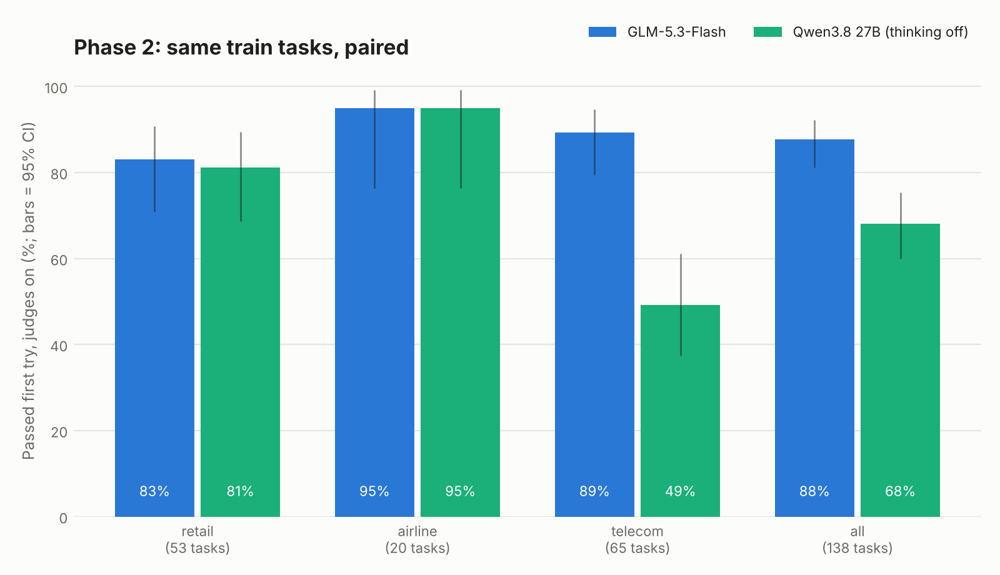

# Teacher bake-off, phase 2: GLM-5.3-Flash is the teacher (3 Nov 2026, SEL-58)

> **Status: final.** The fixes became the golden trajectories v1 dataset on 4 Nov:
> [`GOLDEN_TRAJECTORIES_V1.md`](GOLDEN_TRAJECTORIES_V1.md).

**Decision: GLM-5.3-Flash.** On the full τ²-bench train split (178 tasks across retail, airline
and telecom, with judges on), it passes **88% on the first try** and produces a verified fix for
**158 of the 178 tasks**. That cost **$11** in total. On a paired comparison over the same 138
tasks, it ties Qwen3.8 27B (thinking off) on retail and airline, and **beats it decisively on
telecom (89% vs 49%, p < 10⁻⁶)**.

Phase 1 (screen, 30 tasks): [`TEACHER_BAKEOFF_RESULTS.md`](TEACHER_BAKEOFF_RESULTS.md).
Reproduce with `python scripts/phase2_report.py` (needs the `results/fixes/*.jsonl` files).

## Why we tested Qwen with thinking off

Phase 1 left a statistical tie between the two finalists: Qwen3.8 27B scored 30/30 and
GLM-5.3-Flash 27/30 (p = 0.25). They work differently, though:

- **Qwen thinks before each step.** In phase 1 it wrote ~520 output tokens per turn behind a
  short visible reply. GLM wrote ~175.
- **Our fixes keep only what's visible:** messages and tool calls. The reasoning isn't saved,
  and the student, Aya Expanse 32B, isn't a thinking model.
- **So the student learns the teacher's actions without the reasoning behind them.** If a
  teacher succeeds because of hidden reasoning, its fixes may be harder to imitate. A teacher
  that succeeds *without* thinking leaves fixes whose reasoning is all on the page.

Turning Qwen's thinking off (OpenRouter `reasoning: {enabled: false}`) asks: **can Qwen still
solve these tasks when it can't think first?** If it could, it would be an equally imitable
second teacher. It worked as intended: Qwen's output dropped to **67–95 tokens per turn**.

We didn't run thinking-on Qwen on these tasks, to save cost. So the gap below shows how Qwen
does *without* thinking, not how much the thinking itself was worth.

## Setup

- **Tasks:** every τ²-bench v2.0 train task in all three domains: 74 retail, 30 airline,
  74 telecom.
  - GLM ran all 178.
  - Qwen ran the 148 that phase 1 hadn't used, and stopped 9 telecom tasks short (credits),
    so it has 139.
  - The comparison uses the **138 tasks both finished**. It's paired: the same tasks for both.
- **Attempt 1 at temperature 0** for the comparison. Earlier GLM runs had extra attempts for
  22 retail tasks; those count as fixes, but not in the comparison.
- **Scoring:** τ²-bench's own evaluator, **judges on** (retail NL assertions on
  `gpt-5.4-mini-2026-03-17`, airline communicate on `gpt-5.5`). Telecom has no judges.
- **Simulated customer:** GPT-4.1 via OpenRouter (`openai/gpt-4.1`), with replies capped at
  2,048 tokens.
- **Teachers:** native tool calling via OpenRouter, with providers required to support every
  parameter we send. Providers weren't pinned; see Limitations.

## Results

**Paired comparison, attempt 1, 138 shared tasks**

| Domain | Tasks | GLM-5.3-Flash | Qwen3.8 27B, thinking off | Only GLM passed | Only Qwen passed | Exact McNemar p | GLM − Qwen (95% bootstrap) |
|---|---:|---:|---:|---:|---:|---:|---|
| Retail | 53 | 44 (83%) | 43 (81%) | 3 | 2 | 1.0 | −6 to +9 pts |
| Airline | 20 | 19 (95%) | 19 (95%) | 0 | 0 | 1.0 | 0 |
| Telecom | 65 | 58 (89%) | 32 (49%) | **28** | 2 | **9×10⁻⁷** | **+26 to +52 pts** |
| **All** | **138** | **121 (88%)** | **94 (68%)** | **31** | **4** | **4×10⁻⁶** | **+12 to +28 pts** |

**GLM-5.3-Flash on the whole τ²-bench train split (178 tasks)**

| Domain | Pass, first try (judges on) | 95% CI | Database checks only | Fix exists (any attempt) | Cost |
|---|---:|---|---:|---:|---:|
| Retail | 62/73 (85%) | 75–91% | 65/73 | 64/74 | $1.87 |
| Airline | 28/30 (93%) | 79–98% | 29/30 | 28/30 | $0.49 |
| Telecom | 66/74 (89%) | 80–94% | 66/74 | 66/74 | $8.84 |
| **All** | **156/177 (88%)** | **83–92%** | 160/177 | **158/178 (89%)** | **$11.20** |

One retail task has later attempts but no attempt-1 record, so the first-try column is out of
177. In total there are **193 clean fixes** across the 158 tasks: passing conversations with no
failed-call retries and no unknown tools.

## What the numbers say

1. **Retail and airline are a dead heat.** That confirms phase 1. On those domains, either
   teacher would do.
2. **Telecom decides it, and the way the models fail is telling.**
   - **Qwen, thinking off:** all 33 of its telecom failures end with a **hand-off to a human
     agent** (`transfer_to_human_agents`), often after only 2–6 tool calls. It escalates instead
     of troubleshooting. Its success rate falls steeply with the number of faults in the task:
     9/15 with 2 faults, 2/8 with 6, 0/3 with 7.
   - **GLM:** never hands off on a failure. Its 8 telecom failures all hit the **step limit**,
     still working through the checklist, and 5 of the 8 are tasks with 6 or more faults. It
     solves 17/17 with 3 faults and 4/4 with 8.
3. **The judges barely change GLM's score:** 88% judged against 90% on database checks alone.
   GLM tells customers the right things, not just does the right things.
4. **GLM's visible trajectories are imitable.** It writes ~110–290 tokens per turn, so little
   is hidden behind the visible reply. And it's cheap: the teacher itself cost **$1.80** for
   the first attempts on all 178 tasks. The rest of the $11.20 is the simulated customer, mostly in telecom.
5. **Everything fits the student.** The longest prompt was ~12.6K tokens (estimated), against
   Aya Expanse 32B's 128K window. That's also under a 16K training cap, should the Trainer
   need one.

## How this compares with published τ²-bench results

- **OpenRouter's τ²-bench airline board** (all airline tasks, its own setup): GLM-5.3-Flash
  75.6%, Qwen3.8 27B 77.5%, GLM-4.7-Flash 66.7%.
  - Our airline numbers are higher (93–95%). They're the train split, and use our harness and
    customer settings, so they aren't comparable as absolutes.
  - The *ranking* agrees: GLM-5.3-Flash and Qwen3.8 are close, both well above GLM-4.7-Flash.
- **Telecom:** aggregators report very high telecom scores for the GLM-5.x family on
  third-party setups. That's consistent with GLM's 89% here, and the gap to thinking-off Qwen
  is the clearest result in either phase.
- **Our scores aren't official leaderboard numbers.** They're train tasks, a single trial and
  OpenRouter's GPT-4.1 as the customer. We report τ²-bench test-split results only for the
  final four-arm evaluation (SEL-26).

## Limitations

- **One attempt per model per task** for the comparison. The simulated customer is itself an
  LLM, so a rerun can move a few tasks. Nowhere near enough to close a 26-point telecom gap.
- **Thinking-on Qwen wasn't tested on telecom,** so we can't say whether its thinking would
  have avoided the hand-offs.
- **Providers weren't pinned.** GLM was served by Wafer (retail), InferenceNet (airline) and
  Friendli/OpenInference (telecom). Qwen was served by ModelRun and DekaLLM. Provider
  differences (quantisation, tool-call parsing) are a small confound; every record stores its
  provider.
- **The customer was OpenRouter's `openai/gpt-4.1`,** not the dated snapshot τ²-bench pins.
  It's the same model family as in phase 1, so comparisons hold.
- **The fixes still need checking** before training: conversion to Aya's prompted format and
  re-scoring (SEL-9, SEL-35), and removing any dev-split tasks (SEL-36).

## Decision and next steps

- **Teacher:** **GLM-5.3-Flash (MIT licence).** Qwen3.8 27B (thinking off, Apache-2.0) is
  acceptable as a *second* teacher for retail and airline only.
- **The fixes exist already:** 193 clean fixes for 158 of the 178 train tasks, in
  `results/fixes/glm53f.jsonl`. The other 20 tasks (10 retail, 8 telecom, 2 airline) have no
  fix yet. They're the hard subset's core (SEL-7), and could get retries at temperature 0.7.
- **After this (4 Nov), all done:**
  1. Dev split frozen (SEL-36): `configs/splits.json`, 36 dev tasks.
  2. Fixes converted to Aya's Cohere format and checked (SEL-9): `just golden`.
  3. Packaged as **127 training + 31 dev reference records**, ready for a private upload
     (SEL-48): `just golden-publish`. See [`GOLDEN_TRAJECTORIES_V1.md`](GOLDEN_TRAJECTORIES_V1.md).
